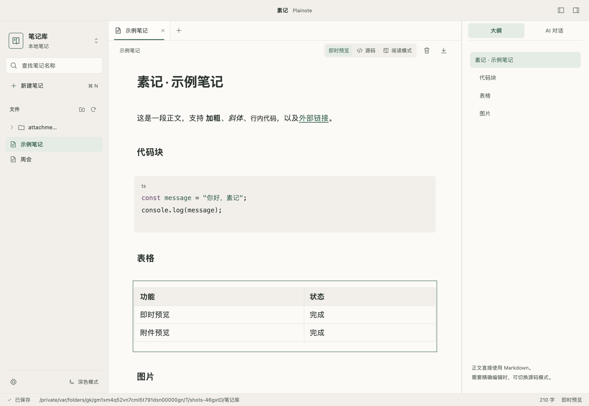
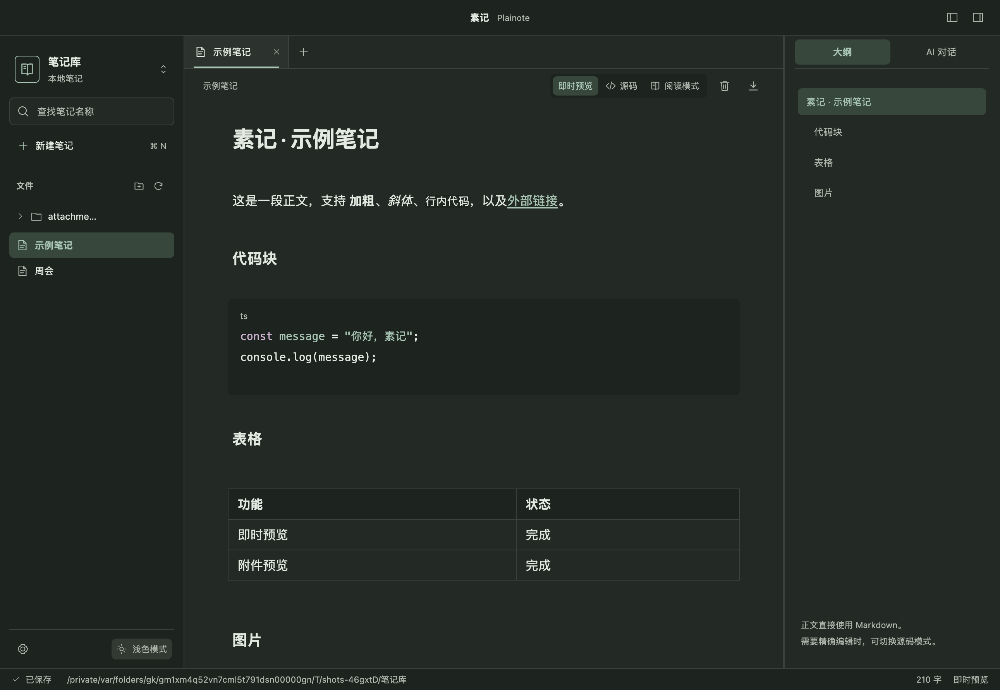
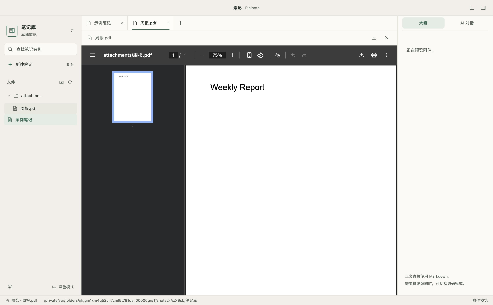
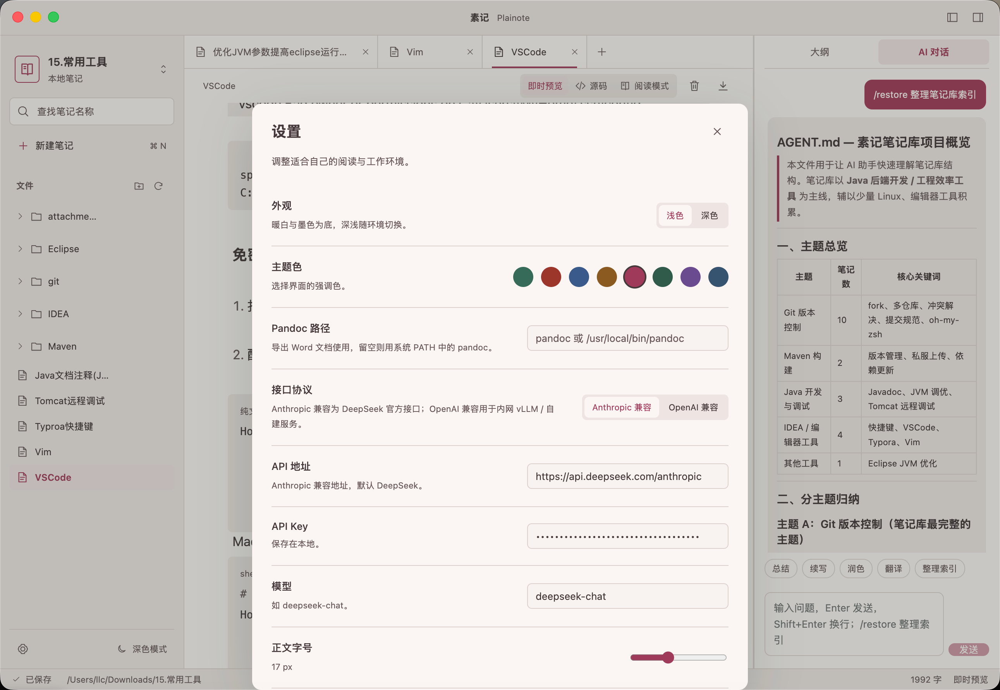

# 素记 Plainote

**本地优先的 Markdown 工作笔记桌面应用。**

素记把笔记直接存成真实的 `.md` 文件，放在你选定的本地文件夹里——不导入、不转换、不需要账号，数据始终由你掌控。它用接近所见即所得的「即时预览」来编辑 Markdown，同时保留随时切换到「源码」和「阅读」模式的自由，适合整理会议记录、项目资料、工作日志和简单待办。

界面采用「温润素雅」的暖白/墨色基调与文稿居中的排版，内置 8 种主题色与深浅两种模式，长时间写作也不累眼。支持 macOS 与 Windows。

## 核心特性

- **本地优先**：直接读写真实 `.md` 文件，隐藏目录与符号链接不参与扫描；单篇上限 20 MB。
- **即时预览**：标题、强调、行内代码、待办勾选、代码块与语言高亮、多行引用、列表、分隔线、链接、GFM 表格、图片，实时渲染；支持「即时预览 / 源码 / 阅读」三种模式。
- **Mermaid 图表**：正文中的 `mermaid` 代码块可离线渲染，支持深浅主题、宽图横向滚动和语法错误提示；点击图表或聚焦后按回车编辑源码。
- **图片与附件**：截图粘贴、拖入图片自动保存到可配置的附件目录并插入引用；图片、文本、Markdown、PDF、音视频等附件可在应用内直接预览（标签页方式），也可转系统默认应用打开。
- **文件管理**：目录树（含空目录）、多标签、名称/路径筛选、快速打开；新建、重命名、跨目录移动（支持拖拽）、删除（移入系统回收站）。
- **引用维护**：重命名或移动笔记/目录时，自动同步更新其它笔记指向它的链接、图片与双向链接引用，并重算被移动笔记自身的相对路径；歧义引用保留原文。
- **可靠保存**：自动保存，保存前写恢复副本；外部修改检测、版本冲突比较、另存副本；异常退出后可恢复未保存内容。
- **原文保真**：BOM、未编辑部分的换行、YAML 与未知 Markdown 语法原样保留。
- **外观**：浅色/深色主题 + 8 种主题色（青绿/砖红/靛蓝/琥珀/玫瑰/松绿/黛紫/墨蓝）、正文字号、侧栏收起、右侧面板拖动调宽、系统窗口操作。
- **导出 DOCX**：用 Pandoc 把笔记导出为 Word 文档；Mermaid 代码块自动转成浅色高清 PNG 嵌入文档，并按页面尺寸缩放。
- **AI 对话**：右侧面板把整个笔记库当作一个项目来回答（对接 DeepSeek / OpenAI 兼容服务）。

## 界面截图

主界面（即时预览，含代码块、表格与图片）：



深色模式：



附件预览（PDF 在应用内以标签页打开）：



设置面板（主题、主题色、正文字号、附件位置与 AI 配置）：



## 快速开始

1. 从 [Releases](../../releases) 下载对应平台的安装包，或自行构建（见下文「开发」）。
2. 启动后点击「打开笔记库」，选择一个已有的 Markdown 文件夹；应用会直接读取其中的 `.md` 文件。
3. 开始编辑；内容会自动保存到原文件。下次启动会重新打开最近的笔记库。

快捷键：Mac 使用 ⌘，Windows 使用 Ctrl——`O` 打开笔记库、`P` 快速打开、`N` 新建笔记、`S` 保存、`,` 打开设置。

在笔记中输入以下代码，离开代码块或切换到「阅读模式」即可查看图表：

````markdown

````

Mermaid 支持笔记正文预览与 DOCX 图片导出；AI 回复和附件预览暂未接入图表渲染。点击「导出 DOCX」即可自动转换，无需额外安装 Mermaid CLI。图表语法错误时会提示图表序号并停止导出，保留已有目标文件和笔记原文。

## 开发

### 环境要求

- Node.js 22.12+ 与 npm
- 首次安装会联网下载 Electron

### 安装依赖

```sh
npm ci
```

`npm ci` 按 `package-lock.json` 精确安装依赖，比 `npm install` 更快、更可复现，推荐在首次安装与 CI 环境使用。

### 开发模式运行

```sh
npm run dev
```

启动 Vite 开发服务器 + Electron 窗口，源码改动会热更新，适合边改边看。

### 编译构建

```sh
npm run build
```

完整构建分三步：①类型检查 `tsc --noEmit`（渲染层 + 主进程）；②把主进程编译到 `dist-electron/`；③用 Vite 把渲染层打包到 `dist-renderer/`。

### 运行构建版

```sh
npm start
```

运行构建后的版本（需先执行 `npm run build`）。

## 测试

```sh
npm run typecheck   # 类型检查
npm test            # 单元测试
npm run test:desktop  # 桌面保存/冲突/恢复回归
npm run test:markdown # Markdown 预览桌面验证
npm run test:mermaid  # Mermaid 渲染与源码编辑桌面验证
npm run test:docx     # Mermaid 图片嵌入 Word 的导出验证（需要 Pandoc 与 Python 3）
npm run test:files    # 文件管理桌面验证
npm run test:reading  # 阅读模式桌面验证
npm run test:attachments # 图片附件与导入桌面验证
npm run test:move       # 移动/删除目录与引用维护桌面验证
```

| 命令 | 作用 |
|---|---|
| `npm run typecheck` | 渲染层 + 主进程的 TypeScript 类型检查（不改动任何产物）。 |
| `npm test` | 单元测试：文件服务、保存/冲突、原文编辑、引用改写、附件与 AI 检索等。 |
| `npm run test:desktop` | Electron 集成测试：真实 Markdown 读写、保存、冲突、取消退出、异常退出恢复。 |
| `npm run test:markdown` | 代码块/表格/链接/引用等即时预览的桌面验证。 |
| `npm run test:mermaid` | Mermaid 离线渲染、主题、错误恢复、源码编辑和宽图滚动。 |
| `npm run test:docx` | 实际 Pandoc 导出、图表 PNG 嵌入及页面尺寸、相对图片资源、失败保护与清理。测试需安装 Pandoc 和 Python 3，可通过 `PLAINOTE_TEST_PANDOC` 指定 Pandoc。 |
| `npm run test:files` | 新建目录、删除笔记、回收站等文件管理桌面验证。 |
| `npm run test:reading` | 阅读模式的只读、待办勾选、模式切换桌面验证。 |
| `npm run test:attachments` | 图片语法预览/放大/缺失占位、粘贴拖入导入、附件位置配置、点击打开附件。 |
| `npm run test:move` | 重命名/跨目录移动更新引用、目录删除确认与系统回收站。 |

桌面测试需要图形桌面环境，使用临时笔记库与独立应用数据目录，不会写入真实笔记；运行前应先 `npm run build`，且各桌面脚本应顺序运行以避免原生焦点互相干扰。

## 打包与发布

```sh
npm run package   # 当前平台应用目录（未打包成安装包）
npm run dist      # 当前平台安装包
npm run dist:win  # Windows 安装包 + 免安装 ZIP
```

| 命令 | 作用 |
|---|---|
| `npm run package` | `npm run build` 后用 `electron-builder --dir` 生成当前平台的应用目录（如 `release/mac-arm64/素记.app`），用于快速本地验证。 |
| `npm run dist` | 生成当前平台的安装包（macOS 为 dmg）。 |
| `npm run dist:win` | 交叉构建 Windows x64 的 NSIS 安装包 + 免安装 ZIP（`--publish never`）。 |

输出在 `release/`：macOS 为 `素记-<版本>-<架构>.dmg`，Windows 为 `Plainote-<版本>-Setup-x64.exe` 与 `Plainote-<版本>-Windows-x64.zip`（ZIP 需完整解压后运行）。

> 当前产物未签名：macOS 首次打开需「右键 → 打开」绕过，Windows 会触发 SmartScreen 提示。正式分发需配置代码签名与（macOS）公证。

推送 `v*` 标签会触发 `.github/workflows/release.yml`，自动构建 macOS 与 Windows 安装包并创建 GitHub Release（版本号自动取 tag）：

```sh
git tag v0.2.0
git push origin v0.2.0
```

## 技术栈

- **Electron** — 桌面框架
- **React + TypeScript** — 界面与逻辑
- **CodeMirror 6** — 编辑器与即时预览
- **markdown-it** — Markdown 渲染（AI 回复与附件预览）
- **Mermaid** — 笔记正文图表渲染
- **electron-builder** — 打包与安装包
- **Pandoc** — DOCX 导出

## 后续规划

已实现的内容见「核心特性」。仍在计划中的方向包括：

- **全文搜索**：独立的正文搜索界面（目前支持文件名/路径筛选，内容检索由 AI 对话承担）。
- **模板**：内置会议记录、项目文档、工作日志等 Markdown 模板。
- **链接能力增强**：双向链接补全与导航、反向链接面板、标题与块定位跳转。
- **导航**：浏览前进/后退、多个最近笔记库列表。
- **元数据**：YAML 标签/别名的语义识别与检索。
- **历史版本**：已保存版本的历史列表与回滚。
- **偏好**：字体选择、更多外观选项。
- **AI 扩展**：更大规模的笔记库检索、向量检索等。
- **发布完善**：Windows 实机验证、代码签名、macOS 公证、自动更新。

数学公式与 HTML 渲染、同步、账户、插件市场等暂不在此规划内。

## 项目结构

- `src/electron/`：本地文件服务、有限 IPC、AI/Pandoc 集成、窗口与菜单。
- `src/renderer/`：桌面界面、CodeMirror 编辑器、附件预览、AI 面板与主题。
- `src/shared/`：保存会话、恢复与原文编辑逻辑、引用扫描/改写、共享类型。
- `tests/`：文件服务、编辑保存、引用改写、AI 检索与桌面集成验证。
- `docs/plans/`：产品决策、设计规范与阶段计划。
- `.github/workflows/`：标签触发的多平台自动发布。
